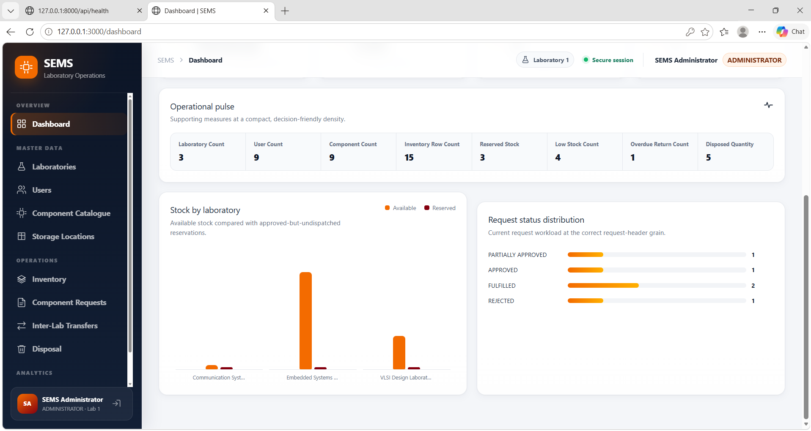
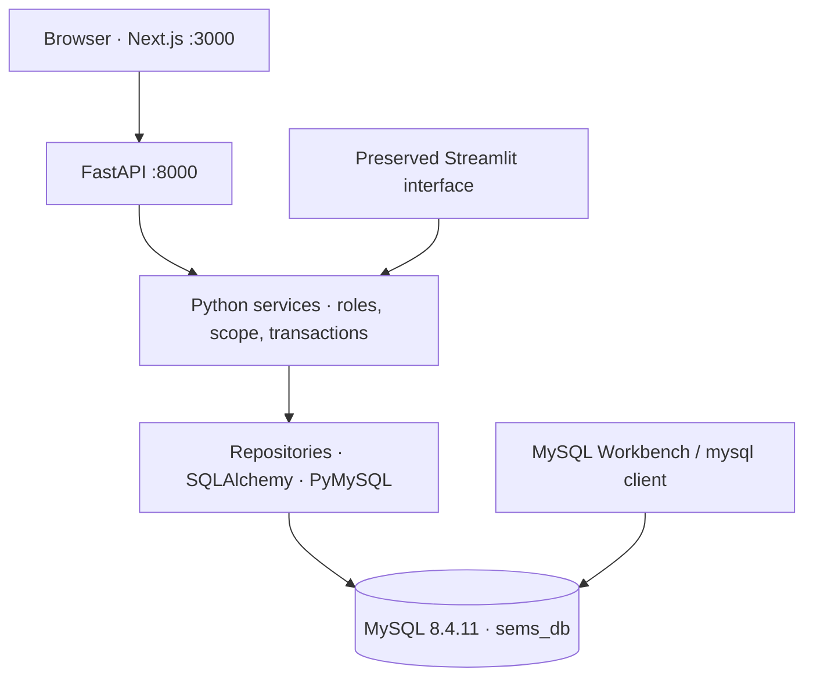
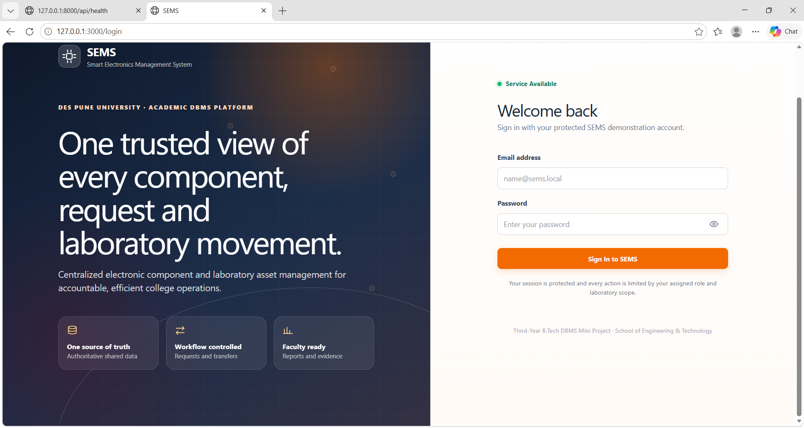
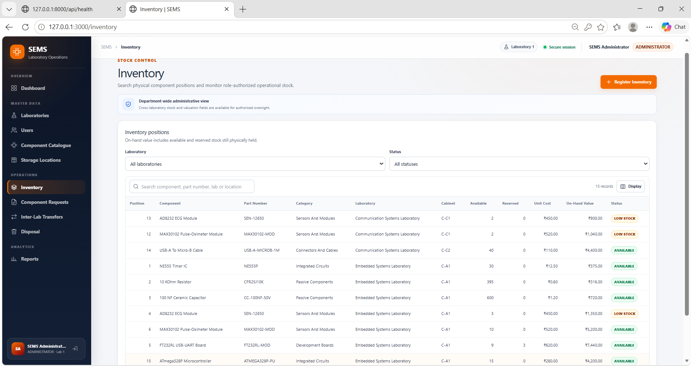

# MatCount · SEMS

## Smart Electronics Lab and Component Management System

Centralized electronic-component stock, laboratory requests and accountable inter-laboratory movement, implemented in MySQL and demonstrated through a role-aware web application.

**DES Pune University · School of Engineering and Technology**

Third Year B.Tech Electronics and Communication Engineering (AI & ML) · Division A · Semester I · AY 2026–2027



*Genuine 10 October 2026 capture; displayed totals are a dated demonstration state. Images are preserved byte-for-byte. MatCount is the repository/product name; SEMS is the established application and database naming convention.*

### Completed academic project

The repository owner confirmed completion of the faculty demonstration and academic project on **26 October 2026**. The code and genuine dated evidence are retained for portfolio/reference use. The [26 October dependency security maintenance](docs/SECURITY_REMEDIATION_2026-10-26.md) addresses the 93-alert Dependabot inventory with patched dependencies and renewed verification. This maintenance is separate from the historical RC2 package.

### Evidence and release status

The supplied Windows evidence shows a healthy `sems_db`, four-role workflows, persisted faculty review and **all listed laptop acceptance gates PASS**. The independent 11 October review passed **151 Python tests including MySQL integration** and **10 frontend tests**, type checking, lint, tooling compatibility and production build. The npm gate reports zero runtime findings and the existing exact development-only exception. See [dated review and limits](docs/FACULTY_PROGRESS_REVIEW_2026-10-11.md).

The published **v2.0.0-rc.2 archive/tag remains immutable**. This development revision includes the reviewed MySQL CHECK/FK build correction, CHECK regression correction, `source-map-js` 1.2.2 lock update and an explicit quantity-based Reports summary. Laptop evidence is from the privately corrected installation; it does not claim that an unchanged RC2 fresh build had no defect. The evidence in this paragraph describes the 11 October review. Current owner-reported academic completion is recorded above; institutional signatures and plagiarism certification are not independently established by this code review.

## Navigation

| Purpose | Reference |
|---|---|
| Existing installed faculty demonstration | [Current startup and review guide](docs/FACULTY_PROGRESS_REVIEW_2026-10-11.md), [RC2 start page](FACULTY_DEMO_START_HERE.md) |
| New-machine setup | [Windows offline setup](OFFLINE_SETUP_WINDOWS.md), [dependency versions](DEPENDENCY_VERSIONS.md) |
| Design and dependencies | [Physical dictionary](docs/schema_dictionary.md), [formal normalization review](docs/NORMALIZATION_PROOF.md), [ER mapping](docs/ER_TO_RELATIONAL_MAPPING.md) |
| Workbench and academic SQL | [Execution guide](docs/MYSQL_WORKBENCH_EXECUTION_GUIDE.md), [syllabus matrix](docs/ETCS302_SYLLABUS_TRACEABILITY_MATRIX.md), [faculty SQL](docs/FACULTY_DEMO_GUIDE.md) |
| Roles and transactions | [Permission matrix](docs/RBAC_PERMISSION_MATRIX.md), [concurrency/recovery](docs/TRANSACTION_CONCURRENCY_RECOVERY_REPORT.md) |
| Evidence and provenance | [Curated screenshot mapping](docs/screenshots/faculty-2026-10-10/README.md), [historical RC2 validation](VALIDATION_SUMMARY.md), [release integrity](release/README.md) |
| Collaboration and security | [Authors](AUTHORS.md), [contribution guide](CONTRIBUTING.md), [security policy](SECURITY.md) |

## Implemented features

- Laboratory/contact, user/phone, category/component and storage-location masters.
- Free and reserved stock, authorized valuation and low-stock reporting.
- Multi-line requests, bounded approval quantities and partial review results.
- Transfer planning, Administrator approval, reservation, dispatch and receipt.
- Temporary whole-line returns and overdue-return reporting.
- Administrator-authorized disposal and retained event history.
- Seven reporting views, a read-only procedure, a deterministic function, two ownership triggers and formula-safe CSV export.
- Backend role/lab checks and financial minimization, plus isolated academic SQL exercises.

Procurement, serialized asset tracking, QR, maintenance, AI, IoT and cloud hosting are future scope.

## MySQL-centred architecture



Node.js and the browser do not connect directly to MySQL. Workbench is an independent client; the application continues when Workbench closes. The service layer owns validation and atomic workflow changes. The source engine uses READ COMMITTED; stock operations use ordered `FOR UPDATE` locks.

## Technology stack

| Layer | Reviewed source |
|---|---|
| Database | MySQL Community Server 8.4.11, InnoDB, utf8mb4 |
| Backend | Python 3.12, FastAPI, Uvicorn, SQLAlchemy 2.x, PyMySQL |
| Browser interface | Next.js 16.4.3, React 19.3.0, TypeScript 6.0.3, Tailwind 4.3.3 |
| Toolchain | Node.js 24.19.0, npm 11.9.0; locked dependencies |
| Authentication | bcrypt hashes in private local configuration; process-local opaque sessions |
| Verification | pytest, API tests, isolated MySQL integration, Vitest, tsc, ESLint and audit gate |
| Preserved fallback | Streamlit, using the same Python services |

## Database design and integrity

The frozen production contract has **13 relations and 83 columns**:

| Domain | Relations |
|---|---|
| Laboratory and accounts | `lab`, `lab_contact`, `user`, `user_phone` |
| Catalogue and stock | `component_category`, `component`, `storage_location`, `inventory` |
| Demand and movement | `component_request`, `request_item`, `transfer`, `transfer_item` |
| Lifecycle events | `disposal_record` |

Contacts and phones remove repeating groups. Request and transfer lines have stable surrogate identifiers plus unique natural pairs. Keys prevent missing parents and duplicates; checks bound quantities/dates and require distinct transfer laboratories. Two inventory triggers validate location ownership on child writes. Supported workflows also validate permissions and state before committing stock changes.

**Formal normalization boundary:** most master and line relations satisfy 3NF under their stated dependencies. `inventory` retains `storage_location_id → lab_id`; the implied minimal key `(component_id, storage_location_id)` exposes a strict 2NF/3NF exception. `transfer` retains `request_id → destination_lab_id`, a strict 3NF exception under valid-workflow semantics. Nullable part/coordinate uniqueness is qualified. [Lossless logical alternatives and migration impact](docs/NORMALIZATION_PROOF.md) are documented; a blanket “all tables are 3NF” claim is not made.

## Roles

| Role | Permitted emphasis | Boundary |
|---|---|---|
| Administrator | Global masters, requests, transfer approval, disposal and reports | Full laboratory and financial scope |
| Faculty | Own-lab requests/review and related movement monitoring | No financial fields or transfer execution |
| Lab Assistant | Own-lab inventory/storage, planning, dispatch, receipt and returns | Own-lab cost allowed; no disposal/transfer approval |
| Student | Catalogue/availability and own request submission/progress | No cost, coordinates, reserved/accounted quantities or transfer authority |

UI navigation improves usability; server authorization independently validates active identity, role and laboratory. Hiding a link is not the security boundary.

## Reporting

| View | Grain and useful result |
|---|---|
| `v_inventory_detail` | One position; joined location, free/reserved stock and values |
| `v_component_stock_summary` | One lab/component; usable stock consolidated |
| `v_low_stock_components` | One low-stock lab/component; threshold and shortage |
| `v_request_progress` | One request; requested/approved totals and line progress |
| `v_transfer_detail` | One movement allocation; dispatch/receipt/return context |
| `v_overdue_returns` | One eligible overdue temporary item |
| `v_disposal_summary` | One disposal event; current-cost valuation |

The Reports metric totals a named quantity, not numeric IDs, across at most 2,000 returned scoped rows. Disposal values use the current inventory cost rather than an event-time cost snapshot.

## Screenshot gallery

| Sign-in | Position-level inventory |
|---|---|
|  |  |

These are synthetic demonstration records. No credentials, environment files, SQL backups or full screenshot archive are published here. Original names, hashes and report figure numbers are in the [mapping](docs/screenshots/faculty-2026-10-10/README.md).

## Local startup

### Existing configured installation

From the project root, keep two PowerShell windows open:

```powershell
# Window 1: FastAPI
.\.venv\Scripts\python.exe -m uvicorn api.main:app --host 127.0.0.1 --port 8000
```

```powershell
# Window 2: frontend
Set-Location -LiteralPath .\frontend
npm run dev -- --hostname 127.0.0.1 --port 3000
```

Check `http://127.0.0.1:8000/api/health`, then open `http://127.0.0.1:3000`. MySQL must already be running and private local configuration must identify `sems_db`. Do not rerun schema creation, reseeding or dependency restore for an ordinary restart. Use saved local application credentials; no passwords are included in repository documentation.

Stop each server with Ctrl+C, answer Y if prompted and wait for the PowerShell prompt. Save useful Workbench query tabs and resolve any open transaction before closing clients. This does not delete MySQL data.

### New machine or new source checkout

Follow [OFFLINE_SETUP_WINDOWS.md](OFFLINE_SETUP_WINDOWS.md) for the complete ordered process, private configuration and database build. Keep live integration tests in a dedicated database ending `_test`. Never point test setup or reset exercises at valued demonstration data. The immutable RC2 distribution needs the documented compatibility/dependency corrections for a fresh reviewed source build; it is not silently replaced by this revision.

## Validation boundaries

- **Historical RC2 CI:** two supplied JSON records, 17 successful server-independent gates each; live MySQL integration excluded.
- **Target Windows laptop:** SETUP-07 listeners; SETUP-08 healthy MySQL 8.4.11; SS-11 all listed local acceptance gates PASS; four-role captures and request-6 persistence.
- **11 October isolated source review:** 151 Python tests including MySQL integration, 10 frontend tests, type/lint/tooling/build and unchanged audit policy passed.
- **Current security maintenance:** [26 October review](docs/SECURITY_REMEDIATION_2026-10-26.md); both Python locks and full/runtime npm audits have zero known findings. The existing Starlette/httpx deprecation warning remains. Historical audit exceptions describe their dated snapshots, not the current finding count.
- **Boundary:** the missing private installed-folder ZIP prevents full byte reconciliation of all laptop files. This is not final institutional acceptance or a general security certification.

## Academic project and team

| Student (ascending PRN) | PRN |
|---|---:|
| Aaryan Sachin Anand | 1022411049 |
| Deven Sachin Gaikwad | 1022411052 |

Guide: **Dr. Rupali Chopade** · Head of School: **Dr. Prachi Joshi**. Academic context is attribution, not institutional endorsement. Repository ownership/collaboration details remain in [AUTHORS.md](AUTHORS.md) and [CONTRIBUTORS.md](CONTRIBUTORS.md).

## Future extension ideas

The academic demonstration is complete. Any future development is a separate scope: a versioned physical 3NF migration, historical valuation, persistent authentication/audit storage, procurement, serial assets or deployment. Review current dependencies and repeat validation before reusing the source.
